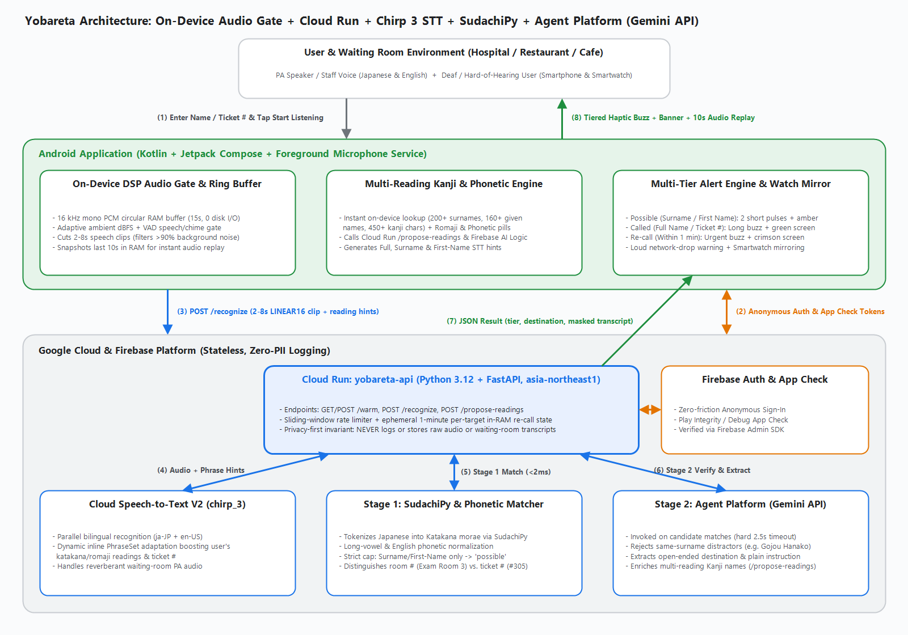
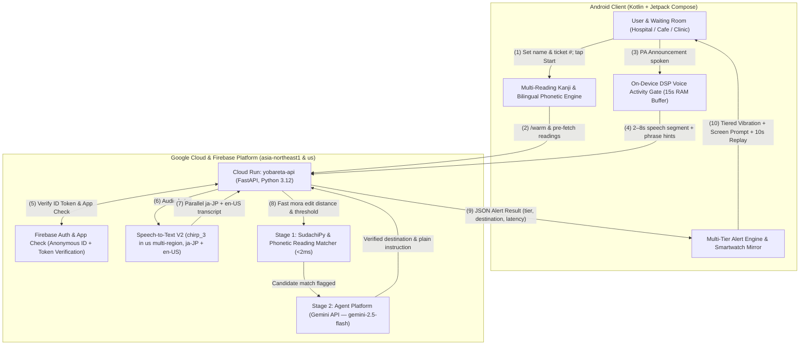

# Yobareta (呼ばれた)

> **Never miss your turn.**  
> An assistive waiting-room call detector and glanceable destination navigator for Deaf, hard-of-hearing, and international individuals.

[](https://github.com/Devfest-Hackathon-2026/df-2026-t044)
[-3DDC84?style=flat-square&logo=android)](app/)
[](backend/)
[-FBBC04?style=flat-square)](backend/stt_client.py)
[-EA4335?style=flat-square&logo=googlegemini)](backend/stage2_gemini.py)
[](LICENSE)

---

## 📌 Overview

Waiting rooms in hospitals, outpatient clinics, pharmacies, restaurants, and cafés are often high-anxiety environments for anyone who cannot hear PA announcements or struggles with Japanese language barriers.

**Yobareta (呼ばれた)** runs continuously in the background on your smartphone. When a staff member or PA announcement calls your specific name (in Japanese or English) or order/ticket number, Yobareta captures the speech, verifies the call in real time, and alerts your phone and paired smartwatch with glanceable, actionable visual and haptic prompts:

$$\text{Spoken PA: } \text{「305番、五条悟様、3番診察室へお入りください」} \implies \mathbf{\text{GO TO: Exam Room 3 (3番診察室)}}$$

---

## 🎯 The Problem

According to the **Japan Hearing Instruments Manufacturers Association (JapanTrak 2025)**:
- Self-reported hearing loss affects **11.0% of Japan’s total population** (over 13 million people) and **33.6% of seniors aged 75+**.
- **Only 15.6%** of individuals with hearing loss in Japan wear a hearing aid in public.
- Over **3 million international residents and tourists** struggle to catch rapid, echoey Japanese PA announcements or recognize their English names when pronounced in Katakana phonetics.

### Critical Gaps in Generic Speech-to-Text Tools (e.g. Google Live Transcribe)

While general-purpose tools like Google Live Transcribe offer a *"Vibrate when name is spoken"* keyword feature, our 26-scenario physical device benchmarks identified six critical failure modes in real waiting rooms:

1. **Spaced & Multi-Reading Kanji Names:** If a user enters a space in their Japanese name (`五条 悟` or `うずまき ナルト`), Live Transcribe **fails to buzz at all** because Japanese ASR outputs continuous text without spaces (`五条悟`). Alternate Kanji readings (`東海林` $\to$ *Shōji* vs. *Tōkairin*) are also missed.
2. **Cross-Language Announcements:** When an English name is called in Japanese Katakana (`ハリー・ポッター様` for *Harry Potter*) or a Japanese name is called in English, single-language keyword matchers fail completely.
3. **Surname False Alarms:** In busy clinics, common surnames (Satō, Suzuki, Smith) are shared by multiple waiting patients. Registering a bare surname causes loud, disruptive false full alarms whenever an unrelated person sharing that surname is called.
4. **Room Number vs. Ticket Ambiguity:** Calling *"Suzuki-san, please enter Exam Room 3 (3番診察室)"* or *"Party of 2 (2名様)"* false-triggers naive number matchers for users holding Ticket `#3` or `#2`.
5. **No Destination or Re-Call Awareness:** Generic transcription simply buzzes and leaves the user scrolling through raw text to figure out which room or counter to visit, with no urgency escalation if it is a repeat call.
6. **Continuous Cloud Streaming Privacy & Battery Drain:** Streaming 100% of ambient clinic audio to the cloud drains battery and exposes bystander patients' private medical conversations.

---

## 💡 Key Features & Architectural Innovations

### 1. On-Device DSP Voice Activity Gate & 15s RAM Ring Buffer
- Captures 16 kHz mono 16-bit PCM into a circular RAM buffer (480 KB, **never written to disk**).
- Adaptive dBFS ambient noise baseline and zero-dependency DSP voice/chime detector filter out **>90% of ambient background noise**.
- Only cuts and uploads short **2–8 s speech clips** when an announcement is detected, reducing cloud bandwidth, latency, and ASR costs by >90%.

### 2. Multi-Reading Kanji & Bilingual Phonetic Engine
- Instant (<1 ms) on-device dictionary covering **200+ multi-reading Japanese surnames**, **160+ given names**, and **450+ per-character Kanji readings**, plus automatic English phonetic respelling (`GOH-joh sah-TOH-roo`).
- Supported by Cloud Run's `/propose-readings` endpoint and Firebase AI Logic.
- Includes convenient **`ENG ←`** and **`日本語 →`** navigation pills and an **`Edit`** toggle in the Compose UI.

### 3. Parallel Bilingual Speech-to-Text V2 (`chirp_3`)
- Transcribes speech segments using Google Cloud Speech-to-Text V2 with the state-of-the-art **`chirp_3`** model in the `us` multi-region.
- In `"auto"` mode, runs **parallel concurrent streams** for Japanese (`ja-JP`) and English (`en-US`) to capture both native and cross-language PA announcements.
- Biased with dynamic inline phrase boosting for the user's name readings and ticket number.

### 4. Two-Stage Hybrid Verification Pipeline
- **Stage 1 (Deterministic SudachiPy & Phonetic Matcher, <2 ms):**
  - Tokenizes Japanese text into Katakana morae via `SudachiPy`, normalizes long vowels (`ショウジ == ショージ`, `サトウ == サトー`), strips honorifics (`様`, `さん`), and computes sliding-window mora edit distance.
  - Normalizes English titles and phonetic variants.
  - Distinguishes caller ticket numbers (`#305`, `A-12` / `Aの12番`) from room numbers (`3番診察室`, `Exam Room 3`) and party sizes (`2名様`).
- **Stage 2 (Google Cloud Agent Platform — Gemini API, 2.5 s timeout):**
  - Invoked **only** on candidate matches (`gemini-2.5-flash`).
  - Disambiguates same-surname callers (e.g. rejects `佐藤花子` when watching `佐藤太郎`).
  - Extracts open-ended destination cards (`Exam Room 3`, `Counter 5`, `Reception`, `Pickup Counter`).

### 5. 3-Tier Haptic & Visual Alert Hierarchy
| Tier | Trigger | Haptic Feedback | Visual Alert | Behavior |
| :--- | :--- | :--- | :--- | :--- |
| **Tier 1 (`Possible`)** | Surname-only or First-name-only match | 2 short subtle vibration pulses | Amber floating card with extracted destination & latency | **Strictly capped:** Never fires a false full-screen alarm on partial names. |
| **Tier 2 (`Called`)** | Full name or Ticket # match | Repeating long attention buzz | Flashing green Full-Screen takeover with destination | Directs user immediately to the correct room/window. |
| **Tier 3 (`Re-Call`)** | Same target called again within 1 minute | Intense urgent vibration pattern | Flashing crimson takeover with `RE-CALL` banner | Signals high urgency. Window strictly expires after 60s or upon name change. |

### 6. 10-Second Instant RAM Audio Replay & Bystander Privacy Masking
- Rolling 15-second audio history kept strictly in volatile RAM.
- A one-tap **"🔊 Replay Last 10s Audio"** button lets a companion, nurse, or the user re-listen to the exact announcement directly through the phone speaker.
- Automatically redacts bystander patient names (`[***]様` / `Mr. [***]`) on screen.

### 7. Smartwatch Mirroring & Fail-Safe Network Drop Warning
- High-priority alarm notifications (`CATEGORY_ALARM`, `IMPORTANCE_HIGH`) automatically mirror to paired **Wear OS / smartwatches** for wrist vibration.
- Actively monitors network connectivity via `ConnectivityManager.NetworkCallback`. If Wi-Fi or mobile data drops, Yobareta **immediately vibrates with a loud offline warning banner** so the app never fails silently.

---

## 🏗️ System Architecture





---

## 📊 Physical Device Benchmark: Yobareta vs. Google Live Transcribe

We evaluated Yobareta side-by-side against Google Live Transcribe on a physical **Samsung Galaxy device** across all 26 standardized waiting-room scenarios ([`eval/calls.csv`](eval/calls.csv)). Results were scored using [`eval/score.py`](eval/score.py):

| Metric | Yobareta | Google Live Transcribe |
| :--- | :--- | :--- |
| **True calls detected (full alert / buzz)** | **13/13 (100%)** | 9/13 (69%) |
| **Surname-only calls noticed (any alert)** | **4/4 (100%)** *(soft amber)* | 0/4 (0%) *(missed entirely)* |
| **Distractors: FALSE full alarms** *(lower is better)* | **1/7 (14%)** | 2/7 (29%) |
| **Distractors: soft Possible alerts** | **2/7 (29%)** | *(no tiers — buzzes or silent)* |
| **Non-calls: false alerts** *(lower is better)* | **0/2 (0%)** | 0/2 (0%) |
| **Correct destination extracted** | **11/13 (85%)** | *(not offered)* |
| **Median latency (end of name $\to$ alert)** | **2.25 s (n=20)** | **< 1.0 s** *(raw word trigger)* |

### Key Findings from Testing
- **Latency Trade-Off (`< 1.0 s` vs. `2.25 s`):** Live Transcribe buzzes in under 1 second on a raw single-word match, but gives no destination. Yobareta captures the complete announcement phrase (`3番診察室へお入りください` / `please proceed to Exam Room 3`) to extract the exact room/counter and verify context, delivering actionable guidance in ~2.25 seconds.
- **Spaced Japanese Names (`C03`):** Entering a Japanese name with a space (`五条 悟` or `うずまき ナルト`) causes Live Transcribe to fail completely because Japanese STT generates unspaced text. Yobareta normalizes whitespace and Katakana morae automatically.
- **Cross-Language Resilience (`A10`, `B04`):** When Japanese names are called in English (`A10`) or English names are called in Katakana (`B04`), Live Transcribe misses them. Yobareta's parallel dual-language STT detects both.
- **Alphanumeric Tickets (`B06`):** Live Transcribe transcribes `"Order A-12"` as `"a 12"`, missing the trigger. Yobareta normalizes ticket numbers (`A-12` / `Aの12番`) and extracts the destination (`Pickup Counter`).

---

## 📁 Repository Structure

```
df-2026-t044/
├── app/                                 # Native Android App (Kotlin + Jetpack Compose)
│   ├── src/main/java/com/example/yobareta/
│   │   ├── alert/AlertEngine.kt         # 3-tier vibration waveform & notification engine
│   │   ├── audio/OnDeviceAudioGate.kt   # DSP energy/ZCR & ambient dBFS gating
│   │   ├── audio/AudioRingBuffer.kt     # 16 kHz circular RAM buffer (15s, 0 disk I/O)
│   │   ├── net/YobaretaCloudClient.kt   # OkHttp client with Firebase Auth & App Check
│   │   ├── service/ListenService.kt     # Foreground microphone capture service
│   │   ├── setup/KanjiReadingProposer.kt# 200+ surname dictionary & phonetic proposer
│   │   └── MainActivity.kt              # Accessible Compose UI with telemetry
│   └── build.gradle.kts                 # compileSdk 35, minSdk 31
├── backend/                             # Google Cloud Run Backend (Python 3.12 + FastAPI)
│   ├── main.py                          # Endpoints: /warm, /recognize, /propose-readings
│   ├── auth_verify.py                   # Firebase Admin SDK Auth & App Check verification
│   ├── stt_client.py                    # Speech-to-Text V2 chirp_3 client (parallel JA+EN)
│   ├── matcher.py                       # Stage 1 deterministic SudachiPy mora matcher
│   ├── stage2_gemini.py                 # Stage 2 Agent Platform (Gemini 2.5 Flash) verifier
│   ├── Dockerfile                       # Container definition with SudachiPy dictionary
│   └── tests/test_matcher.py            # Unit tests for matcher and Stage 2 merge
├── eval/                                # 26-Utterance Benchmark & Evaluation Suite
│   ├── calls.csv                        # Benchmark announcement dataset (JA + EN)
│   ├── results.csv                      # Recorded physical device test results
│   ├── score.py                         # Evaluation scorer & matcher verification
│   ├── generate_audio.py                # Audio synthesizer for all 26 test clips
│   ├── test_audio_e2e.py                # Automated end-to-end HTTP test harness
│   └── Yobareta_Eval_Colab.ipynb        # Interactive Google Colab notebook
├── architecture_diagram.png             # System architecture diagram
└── README.md
```

---

## 🚀 Getting Started

### Prerequisites
- **Android:** Android Studio Ladybug (2024.2+) or newer, physical Android device running Android 11+ (API 31+).
- **Backend:** Python 3.12+, Google Cloud SDK (`gcloud`), Google Cloud Project with Cloud Run and Speech-to-Text V2 enabled.

### 1. Running the Android App
1. Open the repository root in **Android Studio**.
2. Connect your Android smartphone via USB or Wi-Fi debugging.
3. Click **Sync Project with Gradle Files**.
4. Click **▶ Run 'app'**.
5. Grant Microphone and Notification permissions when prompted on the device.

### 2. Deploying the Cloud Run Backend
In **Google Cloud Shell** (project `yobareta`):
```bash
cd ~/df-2026-t044
git pull origin main
gcloud run deploy yobareta-api \
  --source ./backend \
  --region asia-northeast1 \
  --project yobareta \
  --allow-unauthenticated \
  --set-env-vars="GCP_PROJECT_ID=yobareta,STT_LOCATION=us,VERTEX_LOCATION=asia-northeast1,GEMINI_MODEL=gemini-2.5-flash,REQUIRE_AUTH=false,REQUIRE_APP_CHECK=false"
```

### 3. Running the Verification Suite
Verify the deterministic reading matcher:
```bash
python eval/score.py --verify-matcher
```

Score physical device evaluation results:
```bash
python eval/score.py eval/results.csv
```

---

## 🌐 Live Service & Deployed Endpoints

- **Cloud Run Live Status & Warmup Endpoint:**  
  [`https://yobareta-api-696344028704.asia-northeast1.run.app/warm`](https://yobareta-api-696344028704.asia-northeast1.run.app/warm)
- **GitHub Repository:**  
  [`https://github.com/Devfest-Hackathon-2026/df-2026-t044`](https://github.com/Devfest-Hackathon-2026/df-2026-t044)
- **Evaluation Benchmark Suite:**  
  [`https://github.com/Devfest-Hackathon-2026/df-2026-t044/tree/main/eval`](https://github.com/Devfest-Hackathon-2026/df-2026-t044/tree/main/eval)

---

## 👥 Team Information

**Team Name:** Violent Sunshine III  
**Venue:** Nagoya  
**Members:**
- Dip Roy (`sikto1933`)
- Hevidu Samarakoon
- Caleb Faith Adnaka

---

## 📄 License

This project is licensed under the [MIT License](LICENSE).
